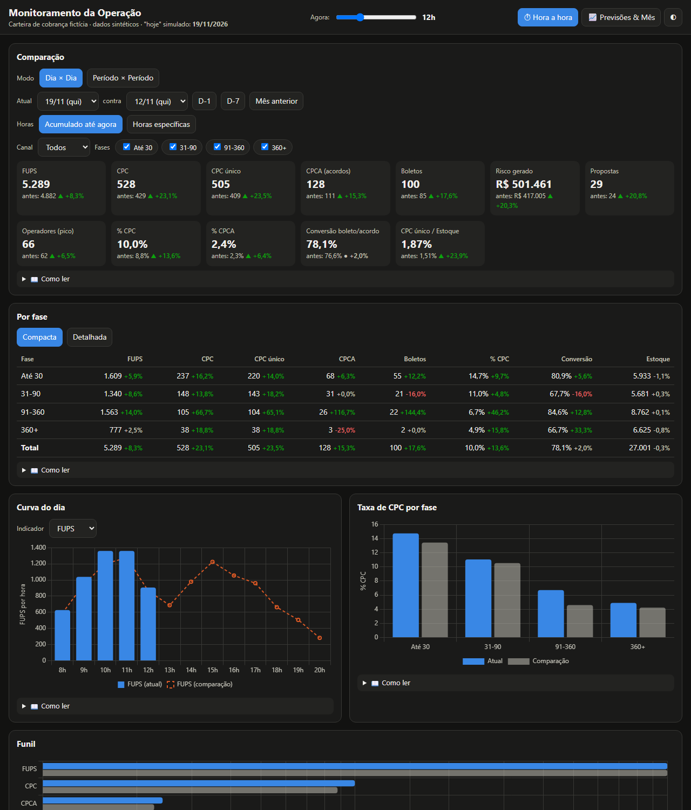

# Monitoramento da operação de cobrança + previsão de fechamento

[](https://github.com/Alajunior/monitoramento-operacao-cobranca/actions/workflows/pages.yml)  [](https://alajunior.github.io/monitoramento-operacao-cobranca/) 

> **Em 30 segundos**
>
> - **Problema:** a operação precisa saber cedo como o dia e o mês vão fechar, e confiar no número.
> - **Como:** previsão por razão de funil com peso nos dias recentes e faixa de 80% calculada fora da amostra, placar de acertos no próprio painel e decomposição LMDI do resultado.
> - **Resultado:** em 250 dias úteis fora da amostra, WMAPE de 6,5% às 10h e de 3,2% às 14h, com viés entre +0,3% e +0,4%. No mês, o erro cai de 2,0% na primeira semana para 0,4% na reta final.

Painel que uma operação de cobrança acompanha o dia todo: produção hora a hora de três carteiras, comparação com qualquer dia ou período, desempenho por fase e faixa de atraso, funil do acionamento ao boleto. Dentro dele, um modelo que **prevê como o dia e o mês vão fechar**, **explica de onde veio o número** e **mostra no placar se acerta**.

**▶ Abrir o painel:** https://Alajunior.github.io/monitoramento-operacao-cobranca/ (abre no navegador, sem instalar nada; funciona no celular)
· [direto nas previsões](https://Alajunior.github.io/monitoramento-operacao-cobranca/?aba=previsoes)

> **Todos os dados são sintéticos**, gerados por [`dados/gerar_operacao.py`](dados/gerar_operacao.py). Nenhum dado real de cliente ou de empresa. O painel reproduz o visual e o funcionamento de um painel que construí e mantenho em produção; o código foi escrito do zero.



## Como usar (2 minutos)

1. **"Agora (simulado)", no topo:** o painel real é ao vivo; aqui ele simula o dia 19/11/2026. Mova o controle de 9h a 20h e tudo se atualiza como se fosse aquela hora.
2. **Versão:** três temas (Midnight, Dark e Light). O fundo de partículas reage ao mouse.
3. **Hora a hora:**
   - **Comparação dinâmica:** compare o dia, até a hora ou em horas específicas, com ontem, sexta passada, o mesmo dia útil do mês passado ou 7 dias atrás. Ou compare dois períodos quaisquer.
   - **12 indicadores:** variação com ▲/▼ e brilho nos que melhoraram.
   - **Desempenho por fase:** tabela compacta ou detalhada, aberta por faixa de atraso, filtrada por canal.
   - **Gráficos:** curva intradiária lado a lado ou sobreposta, conversão por fase e funil.
4. **Previsões & Mês** (carteira principal):
   - **Cartões do mês:** clique num indicador para escolher o que acompanhar.
   - **"Como chegamos neste número":** reproduz, em 6 etapas animadas, a conta da previsão.
   - **Previsão do dia:** troque entre **Ao vivo** e **Fixa** (a previsão das 9h com o desvio hora a hora). Marque **revelar** para ver como o dia simulado realmente terminou.
   - **Confiabilidade e placar:** mostram o histórico de acertos.

Cada gráfico tem uma caixa **📖 Como ler**.


## O que tem por trás

| Parte | Como funciona | Onde |
|---|---|---|
| **Operação sintética** | 3 carteiras, 18 meses de dias úteis, 8h–20h, fases e faixas de atraso, 2 canais. Turno com picos, segunda forte e sexta fraca, começo de mês forte. Cada contrato é sorteado, então **CPC único** (contratos distintos) é menor que **CPC**. Boletos pagos por canal. Dois episódios de mudança | [`dados/gerar_operacao.py`](dados/gerar_operacao.py) |
| **Previsão do dia** | Razão de funil: total do dia ÷ acumulado até a hora, com mais peso nos dias recentes (meia-vida de 30 dias), mais ajuste de viés e faixa de 80% calculada **fora da amostra** | [`src/previsao_dia.py`](src/previsao_dia.py) |
| **Previsão do mês** | Média de dois ritmos (linear e por dia da semana), corrigida pelo viés histórico no mesmo ponto do mês, com faixa de 90%. Também calcula o "previsto na véspera" de cada dia | [`src/previsao_mes.py`](src/previsao_mes.py) |
| **Placar e confiabilidade** | Cada dia passado é previsto **só com os dias anteriores a ele**, em todas as horas de 9h a 20h. O mês só entra no placar depois de fechado | [`src/placar.py`](src/placar.py) |
| **Ofensor** | Decomposição LMDI do CPC único em estoque × esforço × taxa, contra o mesmo dia da semana anterior | [`src/ofensor.py`](src/ofensor.py) |
| **Painel** | O Python calcula tudo, inclusive a previsão de cada hora, e grava **um HTML** com os dados embutidos. O front é HTML, CSS e JS puro, com Chart.js e plugins próprios (linha "agora", rótulos, desvio), fundo em canvas e animações que respeitam `prefers-reduced-motion` | [`src/montar_painel.py`](src/montar_painel.py), [`src/painel.html`](src/painel.html) |

**Por que razão de funil e não um modelo de machine learning?** Num dia normal, "quanto o dia fecha" é um múltiplo estável de "quanto já foi feito". A regra é simples, explicável para a operação e se ajusta sozinha quando o volume muda. Um modelo mais complexo precisaria ganhar dela no placar para valer o custo.

## Resultados (fora da amostra, 250 dias úteis)

| Previsão do dia feita às | Erro (WMAPE) | Viés | Dias dentro da faixa de 80% |
|---|---|---|---|
| 10h | 6,5% | +0,4% | 78% |
| 12h | 5,2% | +0,3% | 77% |
| 14h | 3,2% | +0,4% | 79% |

- **O erro cai ao longo do dia** (7,7% às 9h → 3,2% às 14h → 0,7% às 18h) porque, quanto mais do dia já aconteceu, menos falta prever.
- **Viés perto de zero e cobertura perto dos 80% prometidos:** a faixa é honesta. Às 12h, a previsão acerta a **direção** (acima ou abaixo do esperado) em 82% dos dias.
- **No mês** (CPC único, meses fechados): o erro vai de 2,0% na primeira semana para 0,4% na reta final, e a faixa de 90% acertou em 87% a 97% dos dias, conforme o trecho do mês. A previsão do mês usa só dias fechados: o dia simulado, ainda em andamento, fica de fora.

### Os dois episódios de mudança

- **Out/2026, o estoque da fase 31-90 cai 25%.** O volume cai, mas o **ritmo do dia não muda**: a razão de funil continua certa e a previsão não piora. Mudança de volume não exige retreino.
- **Nov/2026, a tarde passa a render 15% menos** (nova escala de turno). O ritmo muda e a previsão das 12h passa a errar para cima:
  - o **alerta de deriva** (erro médio das 12h nos últimos 5 dias acima de 8%) dispara de 09 a 12/11, com pico de 13,5%;
  - no modo **Fixa**, às 15h do dia simulado, o desvio contra a previsão das 9h chega a −9,7%.
  - O alerta se desliga em uma semana, mas a previsão ainda erra mais que o normal nos dias seguintes, porque o ajuste de viés absorve a mudança aos poucos. É o caso em que um retreino com peso maior nos dias recentes ajudaria.

## Como rodar

```bash
pip install -r requirements.txt
python dados/gerar_operacao.py      # gera as 3 carteiras sintéticas (~10 s)
python -m src.montar_painel         # calcula previsões, placar e confiabilidade e grava docs/index.html (~2 min)
python -m pytest                    # 41 testes
```

Para ver o painel, sirva a pasta `docs/` (por exemplo `python -m http.server --directory docs`) ou abra `docs/index.html`. A cada push na `main`, a CI roda os testes e publica a pasta `docs/` no GitHub Pages ([`.github/workflows/pages.yml`](.github/workflows/pages.yml)).

## Estrutura

```
dados/gerar_operacao.py   3 carteiras sintéticas (produção, eventos de CPC, estoque, faixas, pagamentos)
src/indicadores.py        acionamentos, CPC, CPC único acumulado, derivados
src/previsao_dia.py       razão de funil, ajuste de viés, faixa fora da amostra, alerta de deriva
src/previsao_mes.py       blend de ritmos, faixa histórica, previsto na véspera, etapas do "como chegamos"
src/placar.py             registro reconstruído, WMAPE, viés, cobertura; mês só depois de fechado
src/ofensor.py            decomposição LMDI estoque × esforço × taxa
src/montar_painel.py      monta o JSON por carteira e grava o HTML
src/painel.html           o painel (HTML, CSS e JS puro; Chart.js; fundo em canvas)
docs/                     o painel publicado e as imagens deste README
tests/                    41 testes: dados, indicadores, previsões, placar, montagem, guarda de publicação
```

## Próximos passos

- **Desafiante:** colocar um modelo de ML para disputar com a razão de funil no mesmo placar e só trocar se ganhar.
- **Retreino mais rápido** quando o alerta de deriva disparar (peso maior nos dias recentes).
- **Atualização ao vivo:** ler de um banco a cada hora em vez de dados sintéticos fixos.
