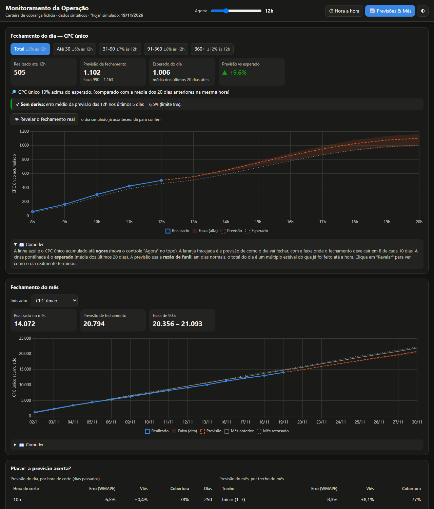

# Monitoramento da operação de cobrança + previsão de fechamento

Painel que uma operação de cobrança acompanha o dia todo: produção hora a hora, comparação com qualquer dia ou período, funil do acionamento ao boleto e, dentro dele, um modelo que **prevê como o dia e o mês vão fechar** e **mostra no placar se acerta**.

**▶ Abrir o painel:** https://SEU_USUARIO.github.io/monitoramento-operacao-cobranca/ (abre no navegador, sem instalar nada; funciona no celular)
· [direto nas previsões](https://SEU_USUARIO.github.io/monitoramento-operacao-cobranca/?aba=previsoes)

> **Todos os dados são sintéticos**, gerados por [`dados/gerar_operacao.py`](dados/gerar_operacao.py) (seed 42). Nenhum dado real de cliente ou de empresa. O painel reproduz o funcionamento de um painel que construí e mantenho em produção; o código foi escrito do zero.


## Como usar (2 minutos)

1. **"Agora" (topo):** o painel simula o dia 19/11/2026. Mova o controle de 9h a 20h e veja tudo se atualizar como se fosse aquela hora.
2. **Hora a hora:**
   - **Comparação:** compare o dia com D-1, D-7 ou o mesmo dia do mês anterior, ou dois períodos quaisquer.
   - **Filtros:** escolha o canal (Discador ou Digital) e esconda fases.
   - **Indicadores:** os 12 cartões mostram a variação com ▲/▼.
3. **Previsões & Mês:**
   - **Previsão do dia:** veja a previsão de fechamento com a faixa de 80%.
   - **Revelar o fechamento real:** o dia simulado já aconteceu, então dá para conferir se a previsão acertou.
   - **Previsão do mês e placar:** a previsão do mês fica logo abaixo, e o placar mostra o histórico de acertos.

Cada gráfico tem uma caixa **📖 Como ler**.



## O que tem por trás

| Parte | Como funciona | Onde |
|---|---|---|
| **Operação sintética** | 18 meses de dias úteis, 8h–20h, 4 fases de atraso, 2 canais. Turno com picos, segunda forte e sexta fraca, começo de mês forte. Cada contrato é sorteado, então **CPC único** (contratos distintos) é menor que **CPC**. Dois episódios de mudança | [`dados/gerar_operacao.py`](dados/gerar_operacao.py) |
| **Previsão do dia** | Razão de funil: total do dia ÷ acumulado até a hora, com mais peso nos dias recentes (meia-vida de 30 dias), mais ajuste de viés e faixa de 80% calculada **fora da amostra** | [`src/previsao_dia.py`](src/previsao_dia.py) |
| **Previsão do mês** | Média de dois ritmos (linear e por dia da semana), corrigida pelo viés histórico no mesmo ponto do mês, com faixa de 90% | [`src/previsao_mes.py`](src/previsao_mes.py) |
| **Placar** | Cada dia passado é previsto **só com os dias anteriores a ele** e comparado com o realizado | [`src/placar.py`](src/placar.py) |
| **Ofensor** | Decomposição LMDI do CPC único em estoque × esforço × taxa, com uma frase automática: "puxado pela queda de estoque na fase 31-90" | [`src/ofensor.py`](src/ofensor.py) |
| **Painel** | O Python calcula tudo, inclusive a previsão de cada hora, e grava **um HTML** com os dados embutidos e gráficos em Chart.js. O GitHub Pages publica | [`src/montar_painel.py`](src/montar_painel.py), [`src/painel.html`](src/painel.html) |

**Por que razão de funil e não um modelo de machine learning?** Num dia normal, "quanto o dia fecha" é um múltiplo estável de "quanto já foi feito". A regra é simples, explicável para a operação e se ajusta sozinha quando o volume muda. Um modelo mais complexo precisaria ganhar dela no placar para valer o custo.

## Resultados (placar, 250 dias úteis)

| Hora de corte | Erro (WMAPE) | Viés | Dias dentro da faixa de 80% |
|---|---|---|---|
| 10h | 6,5% | +0,4% | 78% |
| 12h | 5,2% | +0,3% | 77% |
| 14h | 3,2% | +0,4% | 79% |

- **O erro cai ao longo do dia** (6,5% → 3,2%) porque, quanto mais do dia já aconteceu, menos falta prever.
- **O viés fica perto de zero**, e a faixa cobre perto dos 80% prometidos: ela é honesta, nem estreita nem larga demais.
- **No mês**, o erro vai de 8,3% na primeira semana para 0,5% na última.

### Os dois episódios de mudança

- **Out/2026, o estoque da fase 31-90 cai 25%.** O volume cai, mas o **ritmo do dia não muda**: a razão de funil continua certa e a previsão não piora. Mudança de volume não exige retreino.
- **Nov/2026, a tarde passa a render 15% menos** (nova escala de turno). O ritmo muda e a previsão das 12h passa a errar para cima. O **alerta de deriva** (erro médio das 12h nos últimos 5 dias acima de 8%) dispara de 09 a 12/11, com pico de 13,5%. O ajuste de viés absorve a mudança em cerca de uma semana, e no "hoje" simulado o erro já voltou para 6,5%.

## Como rodar

```bash
pip install -r requirements.txt
python dados/gerar_operacao.py      # gera a operação sintética (~5 s)
python -m src.montar_painel         # calcula previsões e placar e grava docs/index.html (~1 min)
python -m pytest                    # 28 testes
```

Depois, abra `docs/index.html` no navegador. A cada push na `main`, a CI roda os testes e publica a pasta `docs/` no GitHub Pages ([`.github/workflows/pages.yml`](.github/workflows/pages.yml)).

## Estrutura

```
dados/gerar_operacao.py   operação sintética (produção, eventos de CPC, estoque)
src/indicadores.py        FUPS, CPC, CPC único acumulado, derivados
src/previsao_dia.py       razão de funil, ajuste de viés, faixa fora da amostra, alerta de deriva
src/previsao_mes.py       blend de ritmos com faixa histórica
src/placar.py             registro reconstruído, WMAPE, viés e cobertura
src/ofensor.py            decomposição LMDI estoque × esforço × taxa
src/montar_painel.py      monta o JSON e grava o HTML
src/painel.html           o painel (HTML, CSS e JS puro, com Chart.js)
docs/                     o painel publicado e as imagens deste README
tests/                    28 testes: dados, indicadores, previsões, placar, montagem, guarda de publicação
```

## Próximos passos

- **Desafiante:** colocar um modelo de ML para disputar com a razão de funil no mesmo placar e só trocar se ganhar.
- **Previsão por canal**, além de por fase.
- **Atualização ao vivo:** ler de um banco a cada hora em vez de dados sintéticos fixos.
